# Mapping, localization and visual SLAM examples

Mapping and localization with the car's own sensors: ultrasonic sensor (sonar), ESP32 camera and gyro. Everything runs in a pure-MATLAB simulator first, then on the real car.

**Contents:** [Files](#files) · [What is visual SLAM?](#what-is-visual-slam) · [How the five tasks build up](#how-the-five-tasks-build-up-to-slam) · [Task 5 step by step](#task-5-step-by-step) · [Quick start](#quick-start) · [Simulator results](#simulator-results-matlab-r2026b) · [Real car, step by step](#visual-slam-on-the-real-car-step-by-step) · [If something goes wrong](#if-something-goes-wrong) · [Rebuild the student kit](#rebuild-the-student-kit)

<p align="center">
  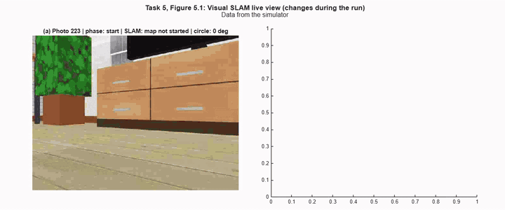
  <br><em>Task 5 in the simulator: the camera photo (left) and the map that visual SLAM builds while the car drives a circle (right).</em>
</p>

## Files

| File | What it is |
|---|---|
| `elegooMappingTemplate.m` | **Student template.** Five tasks in one script, with comments in ASD-STE100 Simplified Technical English. Set `TASK` and `USE_SIMULATOR`, then click Run. |
| `visualSlamDemo.m` | Full visual SLAM demo with a dashboard (`monovslam`), replay and MP4 export. |
| `ElegooSimCar.m` | Simulator: a furnished 5 m x 4 m living room. It has the same commands as `ElegooRobotCar`. |
| `simAssets/` | Room textures for the simulator (AWS RoboMaker Small House World, MIT-0). |
| `calibrateElegooCamera.m` | One-time checkerboard calibration of the ESP32 camera. |
| `README.md` | This file. It is the only guide for students and TAs. The student kit also contains it. |
| `docs/images/` | Example figures from the simulator. This README uses them. |

## What is visual SLAM?

**SLAM** means *Simultaneous Localization And Mapping*. A robot in an unknown room has two questions:

- **Localization:** *Where am I?* To answer it, the robot needs a map.
- **Mapping:** *What is around me?* To draw a map, the robot needs to know where it is.

Each answer needs the other one. SLAM solves both at the same time, a little at each step. **Visual** SLAM does it with a camera. MATLAB's `monovslam` (Computer Vision Toolbox) does it with **one** camera, which is all this car has.

### The key idea: the same corners in two photos

The computer cannot "see" a chair. It finds small, sharp patterns in a photo, called **corners** (ORB features), and finds the same corners again in the next photo. How far each corner moves tells the computer how the camera moved. Corners that move a lot are near. Corners that move a little are far.

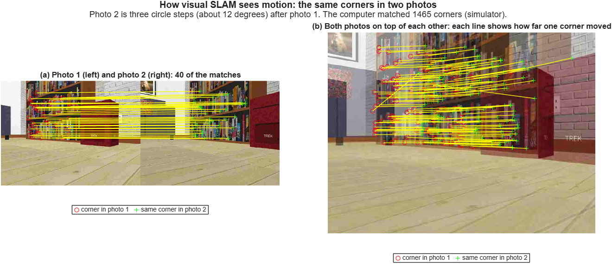

*The car turned left by about 12 degrees between the two photos, so every corner moved to the right (panel b). Blank walls and plain floors have few corners, and that is where visual SLAM gets lost.*

### How visual SLAM works

Visual SLAM repeats the same loop for every photo. Blue = localization (*where am I?*). Green = mapping (*what is around me?*). Yellow = what SLAM does when it is lost.

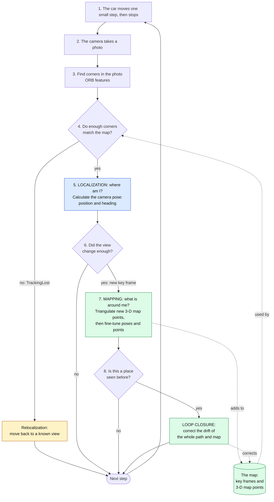

| Step | What it means, in plain words |
|---|---|
| **1. Small step** | The car moves a few cm, stops, and only then takes a photo. The ESP32 camera blurs while the car moves, and the car has no wheel encoders. |
| **3. Find corners** | The computer marks hundreds of small, sharp patterns in the photo (Task 1, Figure 1.1b shows them as green +). |
| **4. Match corners with the map** | It finds the same corners in the map that it built from the earlier photos. |
| **5. Localization: camera pose** | From where the matched corners are in the photo, it calculates where the camera is and which way it points. This answers *where am I?* |
| **6. Key frame** | Not every photo is kept. When the view has changed enough, SLAM keeps the photo as a *key frame*. |
| **7. Mapping: triangulate** | A corner seen from two places gives two lines of sight. Where the lines cross is the corner's 3-D position, a *map point*. This needs **parallax**: the camera must move, not only turn. That is why task 5 starts by driving forward and back. |
| **7. Mapping: fine-tune (bundle adjustment)** | SLAM fine-tunes the key-frame poses and the map points together, so that they agree with all the photos. |
| **8. Loop closure** | Small errors add up as the car moves (*drift*, as in task 4). When the car returns to a place it has seen before, SLAM recognizes it and corrects the whole path and map. This is why task 5 drives 1.25 circles. |
| **Relocalization** | When too few corners match, SLAM is *lost* (`TrackingLost`). The template drives back along its path until SLAM recognizes a known view. |
| **After the loop: scale** | One camera cannot measure size: a small object near the camera and a large object far away can look the same. So the map is in "SLAM units". At the end, the sonar measures a real distance to give the scale in cm. |

## How the five tasks build up to SLAM

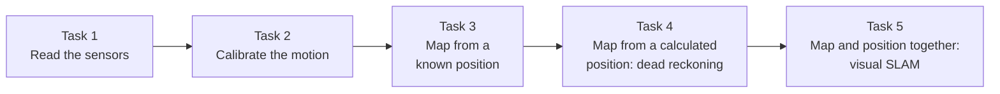

| Task | Car motion | Position from | Map from |
|---|---|---|---|
| 1. Read the sensors | One 0.8 s turn | – | – |
| 2. Calibrate the motion | Up to 8 steps forward and back, then ~400° in place | Sonar (step length), camera (turn angle) | – |
| 3. Sonar map from one spot | None (servo scan) | Known | Sonar occupancy grid |
| 4. Square + dead reckoning | Square, camera-feedback turns | Step count + camera visual odometry | Sonar occupancy grid |
| 5. Visual SLAM | Map-start sweep, ~1.25 circles, scale drive | `monovslam` (loop closure) | Camera map points, sonar scale |

Every figure has a label such as **Task 3, Figure 3.1**. Each panel has a letter: (a), (b) and so on. Examples from the simulator:

<table>
  <tr>
    <td width="50%">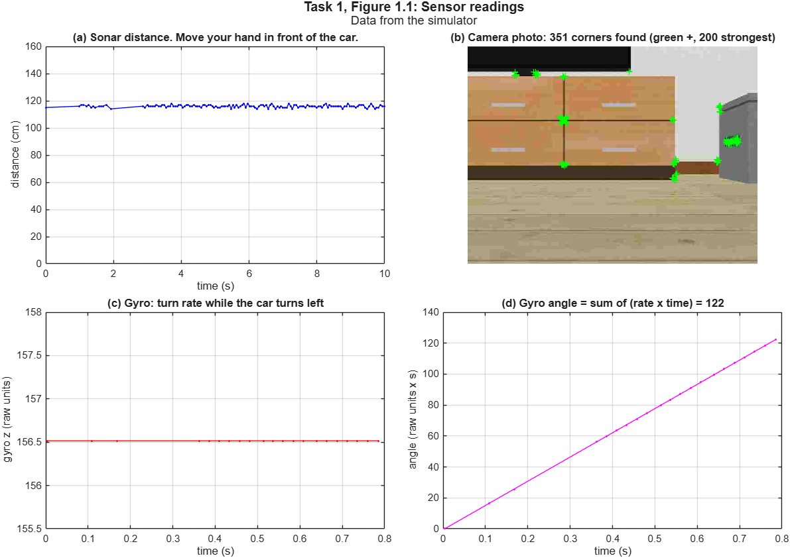<br><b>Task 1, Figure 1.1:</b> sonar distance, camera corners and gyro.</td>
    <td width="50%">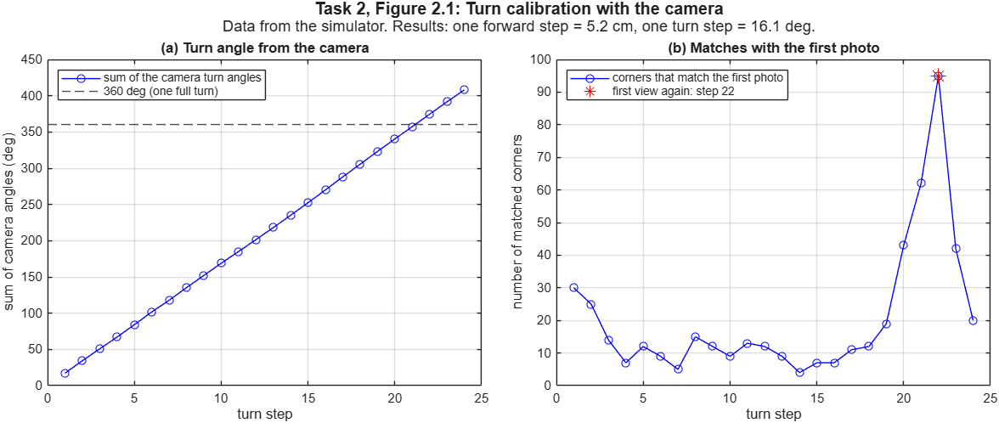<br><b>Task 2, Figure 2.1:</b> the camera measures one turn step; the match with the first photo marks 360 degrees.</td>
  </tr>
  <tr>
    <td width="50%">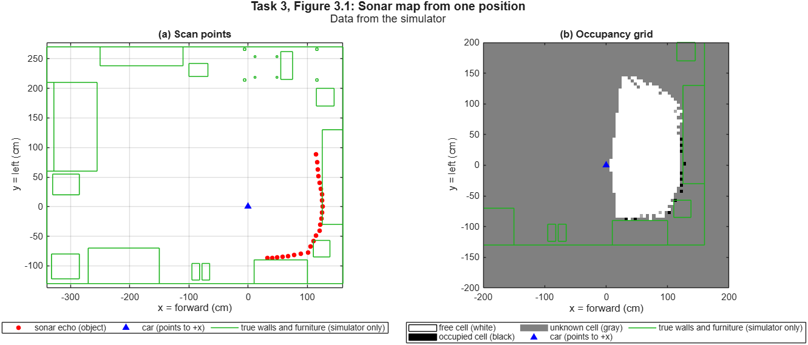<br><b>Task 3, Figure 3.1:</b> a sonar scan and its occupancy grid. The green lines are the true room.</td>
    <td width="50%">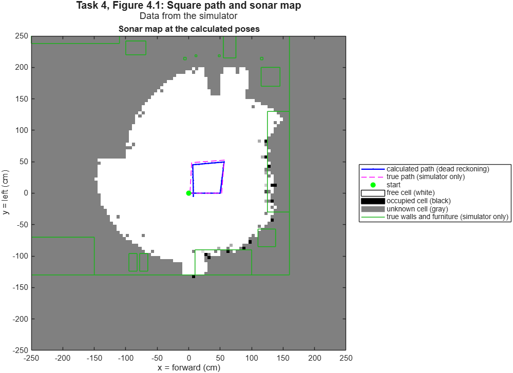<br><b>Task 4, Figure 4.1:</b> the calculated (blue) and the true (magenta) path, and the sonar map.</td>
  </tr>
</table>

## Task 5 step by step

At each photo, task 5 picks a move, takes a photo, gives it to SLAM, and reacts to the SLAM status:

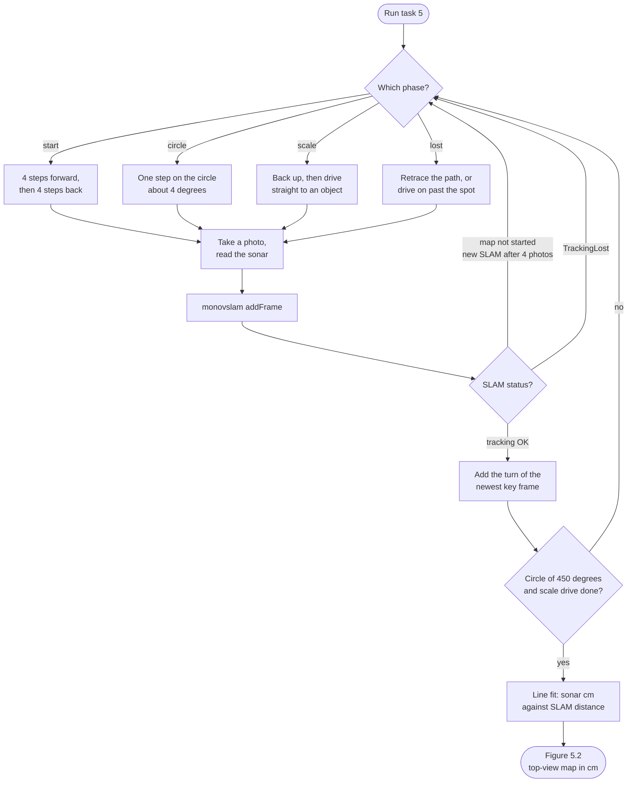

The live view (Figure 5.1, the animation at the top of this page) shows the map **during** the run, in SLAM units. The final map (Figure 5.2) is drawn once **at the end**, after loop closure, in cm, with only the map points 4–80 cm above the floor, and with the true path and room from the simulator:

<table>
  <tr>
    <td width="50%">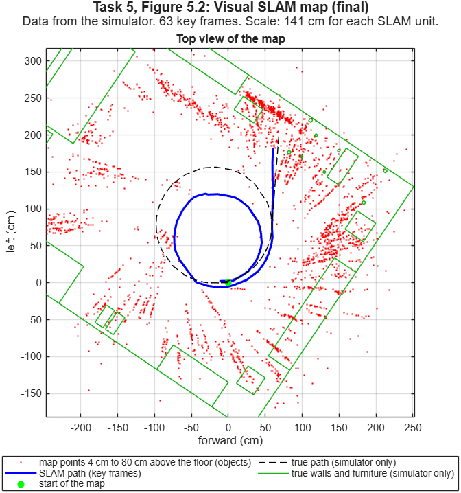<br><b>Task 5, Figure 5.2 (complete run):</b> the SLAM path (blue) closes the circle and lies near the true path (dashed). The red points outline the furniture (green).</td>
    <td width="50%">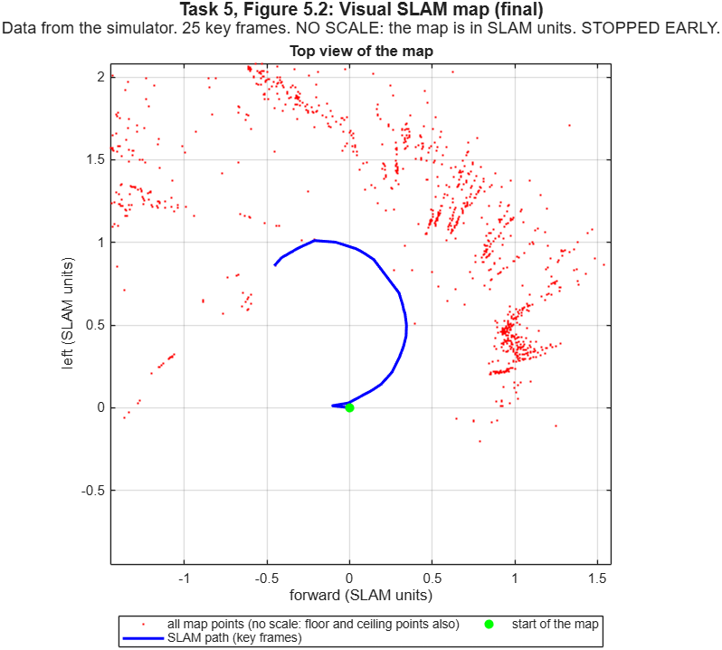<br><b>Task 5, Figure 5.2 (early stop):</b> SLAM got lost on the circle. Only part of the circle, no scale, and the axes are in SLAM units. The subtitle says <code>STOPPED EARLY</code>.</td>
  </tr>
</table>

## Quick start

```matlab
cd vslam_examples
% In elegooMappingTemplate.m set TASK = 1 and USE_SIMULATOR = true, then:
elegooMappingTemplate

visualSlamDemo("sim")      % full demo in the simulator
visualSlamDemo()           % full demo on the real car
```

The vSLAM files find `ElegooRobotCar.m` in `../basic_wireless_control` automatically.

## Simulator results (MATLAB R2026b)

- Task 2: 5.0–5.5 cm per step and 16–18° per turn step (it changes each run).
- Task 4: the square almost closes; the calculated path stays within about 10 cm of the true path.
- Task 5: the map starts after 220–250 photos. Complete runs have 61–67 key frames and the loop closes; the path is 20–40 cm RMS from the truth and the sonar scale error is −40% to +20% (it changes each run). About 2 of 3 runs complete (4 of 6 in our tests, as for visualSlamDemo); the others stop early with lost tracking, which the template reports as "Task 5 stopped early".

These results are from the simulator only (MATLAB R2026b). NOTE: On MATLAB R2026a on a MacBook, the simulated camera shows a lower, narrower view (mostly floor). Task 2 then stops with "too few corners". Use R2026b for the simulator.

## Visual SLAM on the real car, step by step

The first real-car tests started in November 2026. A complete real-car map is not available yet. Do these steps once on one car before students use it.

**Before you leave the internet**

1. Start MATLAB and open this repository.
2. Optional: print the camera calibration board (a checkerboard): in this folder, run `calibrateElegooCamera("print")`. Tape it flat on stiff cardboard and measure one square in mm.

**Connect**

3. Charge the batteries. Car power ON, motor switch **OFF**.
4. Join the car's Wi-Fi network and turn off any VPN. Check that `http://192.168.4.1/capture` shows a photo in a browser.

**Check the car (about 5 minutes)**

5. In `basic_wireless_control/`, run `report = checkCar`, then `save carCheck report`. Answer its y/n questions. It tells you when to lift the car and when to turn the motors on.
6. Type the three values it prints at the top of `ElegooRobotCar.m`. Run `checkCar` again until it says "The file is already correct".

**Calibrate the camera (optional, about 5 minutes)**

You can skip this for a first test. The demo then uses a 60-degree lens. Calibrate later if the map looks bent or SLAM loses track frequently.

7. In this folder, run `calibrateElegooCamera(25)`, using your square size in mm instead of 25.
8. Click the camera window. Hold the board 20 cm to 60 cm in front of the camera at different angles. Press Space for each good photo (green corners), 15 to 20 photos. Then press C to save.

**Set up the room**

9. Clear 2.5 m x 2.5 m of floor, with furniture, shelves, posters or boxes around it. SLAM needs corners: avoid blank walls, shiny floors and sunlight glare.
10. Put the car 0.5 m from the right edge of the area, pointing along that edge (the circle goes to the left). Point the camera at something with detail.

**Run visual SLAM**

11. In this folder, run `visualSlamDemo()` and click **Start Auto Run**. The car drives forward and back until the map starts, then a circle, then straight to an object to measure the scale. Each photo takes 1 to 2 s; a run can take up to 15 minutes. Do not close the MATLAB windows. To stop: Ctrl+C, or lift the car and switch it off.
12. When it ends, click **Finish & Build Map**.
13. Keep `carCheck.mat` and the `vslamRun_...` folder. The folder has every photo and the run log; replay it with `visualSlamDemo("vslamRun_...")`.

**Good to know**

- The sonar sends 0 when nothing is within about 5 m. The code uses 150 cm for it, as the simulator does.
- The car accepts one connection at a time. Close the dashboard before you run the demo or the template.
- `ElegooRobotCar` sets the photo size to 640 x 480 when it connects (`PhotoSize = 10`). Calibrate at that size.

## If something goes wrong

| What you see | Possible cause | What to do |
|---|---|---|
| The photo is colored stripes, or MATLAB shows `Corrupt JPEG data`. | The battery is low. A low battery causes bad photos from the ESP32 camera, also before the car moves. | Charge the battery. Then open `http://192.168.4.1/capture` in a browser. Make sure that the photo is clear. |
| `Step failed (Photo still corrupt after 3 tries ...)`. The car stops. | `ElegooRobotCar` tried 3 times to get a good photo. The battery is low, or the Wi-Fi signal is weak. | Charge the battery. Put the computer near the car. Start the run again. |
| The bottom of the photo is gray. | The Wi-Fi signal is weak, and the photo did not arrive completely. | Put the computer near the car. |
| `Camera 400x296` or another size than 640x480 at the start. | `PhotoSize` at the top of `ElegooRobotCar.m` is not 10. | Set `PhotoSize = 10`. Then run `clear classes`. |
| `No map: SLAM never started`. | The photos are bad, or the room has too few corners. | Look at the photos in the `vslamRun_...` folder. If they are bad, see the first row. If they are clear, add objects with detail around the area. |

## Rebuild the student kit

```matlab
cd tools
makeStudentKit        % -> dist/ElegooMappingKit.zip (no top folder: one folder after unzip)
```
