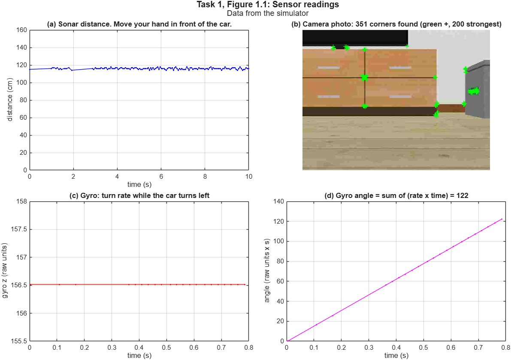
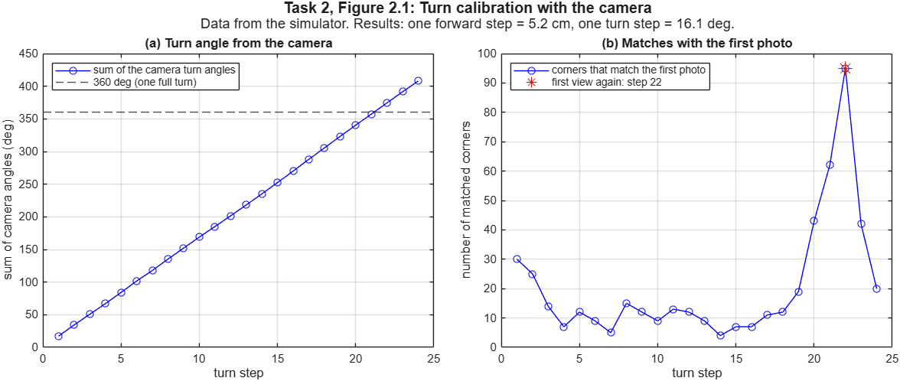
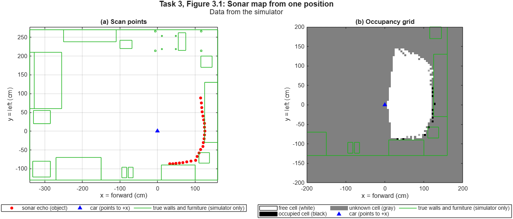
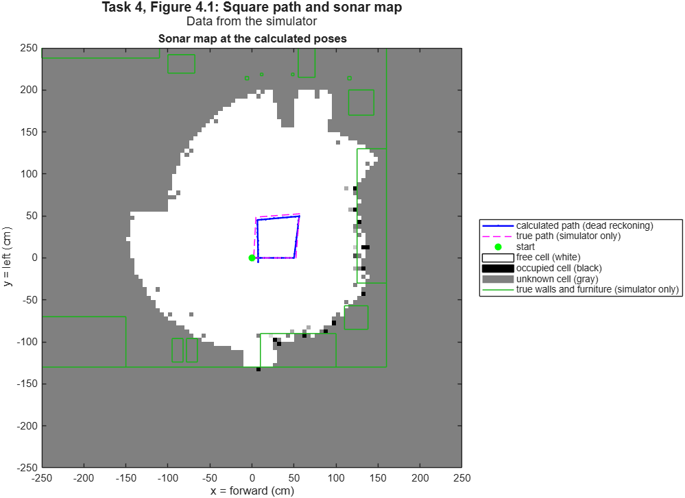
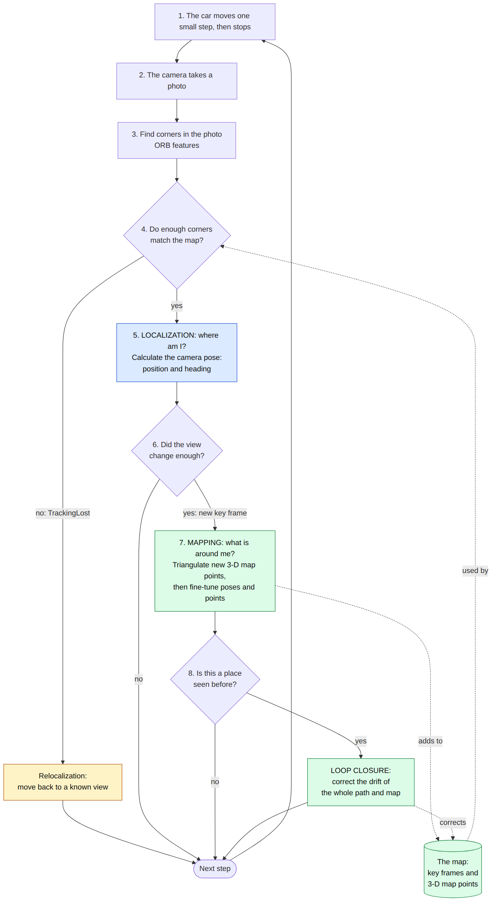
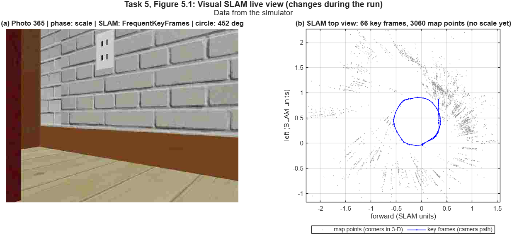
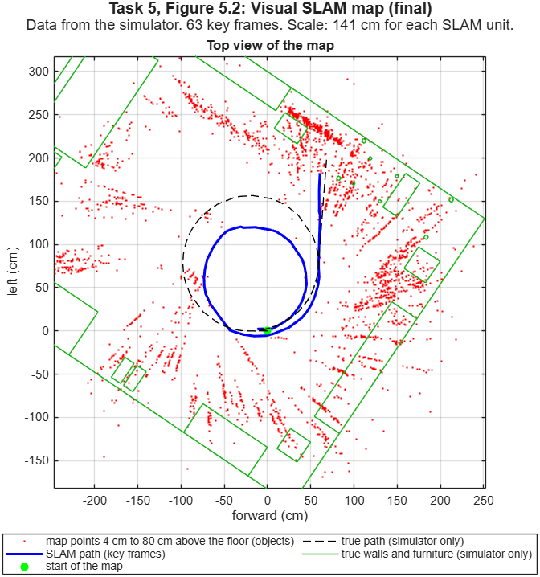
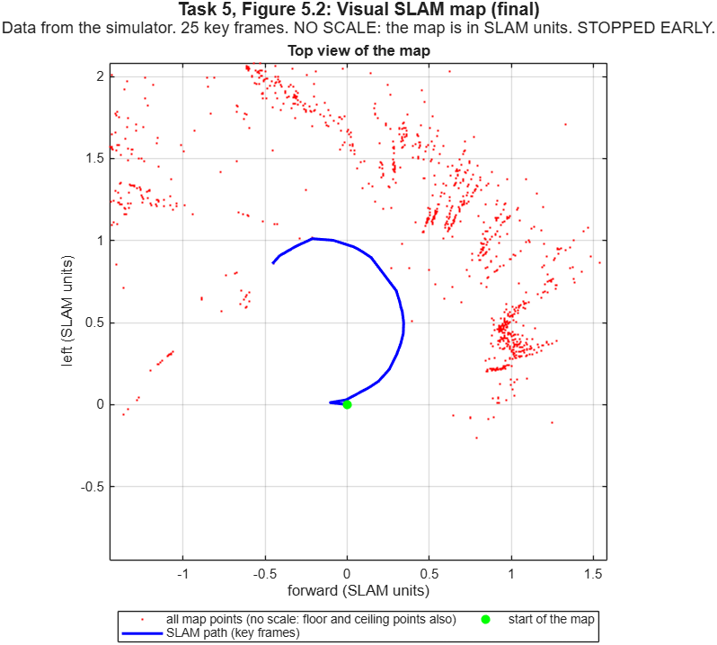

# Student Guide: Map and Position with the ELEGOO Smart Robot Car V4

ROBT 1010 Intro to Robotics Engineering, RPI.
This guide uses ASD-STE100 Simplified Technical English.

**Contents**

1. [Before you start](#1-before-you-start)
2. [How to read the figures](#2-how-to-read-the-figures)
3. [Task 1: Read the sensors](#3-task-1-read-the-sensors)
4. [Task 2: Calibrate the motion](#4-task-2-calibrate-the-motion)
5. [Task 3: Make a sonar map from one position](#5-task-3-make-a-sonar-map-from-one-position)
6. [Task 4: Move in a square, calculate the position and make a map](#6-task-4-move-in-a-square-calculate-the-position-and-make-a-map)
7. [Task 5: Make a camera map with visual SLAM](#7-task-5-make-a-camera-map-with-visual-slam)
8. [Record your results](#8-record-your-results)
9. [If a problem occurs](#9-if-a-problem-occurs)
10. [Words that this guide uses](#10-words-that-this-guide-uses)

---

## 1. Before you start

### 1.1 Purpose

A mobile robot must know two things:

- **Localization:** Where am I? The robot calculates its position and its heading.
- **Mapping:** What is near me? The robot makes a map of the objects near it.

This car has no GPS and no wheel encoders. It uses its sensors for these two functions. Each task adds one new idea to the task before it.

| Task | New idea | Parts that the task uses | Time in the simulator |
|---|---|---|---|
| 1 | What each sensor measures | sonar, camera, gyro | 20 s |
| 2 | Calibration: measure the motion of the car | sonar, camera, motors | 30 s |
| 3 | Mapping when the position is known | sonar, pan servo | 15 s |
| 4 | Mapping when the position is calculated (dead reckoning) | sonar, camera, pan servo, motors | 50 s |
| 5 | Visual SLAM: mapping and localization at the same time | camera, sonar, motors | 4 to 6 min |

On the real car, the tasks can take more time, because of the Wi-Fi delay.

The sensors are the **sonar** (ultrasonic sensor), the **camera** and the **gyro**. The **pan servo** turns the sensor head (sonar and camera) to the left and to the right. The four **motors** move the car.

### 1.2 What you must have

- **MATLAB R2024a or later** (tested with R2026b) on Windows or macOS, with these two toolboxes:
  - Computer Vision Toolbox
  - Image Processing Toolbox

  To examine your toolboxes, type `ver` in the Command Window. Make sure that the two toolboxes are in the list. If a toolbox is not in the list: on the **Home** tab, click **Add-Ons > Get Add-Ons**. Find the toolbox. Install it.
- **The kit folder** `ElegooMappingKit`. Do not move or rename the files in it.
- **For the real car:**

  | Item | Task |
  |---|---|
  | ELEGOO Smart Robot Car V4 with the course firmware and a charged battery | all |
  | The name of the Wi-Fi network of your car (ask your TA) | all |
  | A book and a ruler | 1 |
  | A wall or a large box, approximately 1 m from the car | 2 |
  | Walls, boxes or furniture less than 1 m from the car | 3, 4 |
  | A tape measure and masking tape | 3, 4 |
  | 2.5 m x 2.5 m of clear floor in a room with furniture, posters or boxes | 5 |
  | A printer, paper and a flat, stiff board (camera calibration) | 5 |

### 1.3 Safety

> **CAUTION:** OPERATE THE CAR ON THE FLOOR ONLY. DO NOT OPERATE IT ON A TABLE. THE CAR CAN FALL AND BREAK.
>
> **CAUTION:** KEEP THE CAR AWAY FROM STAIRS.
>
> **CAUTION:** KEEP A CLEAR FLOOR AREA OF 1 m x 1 m (2.5 m x 2.5 m FOR TASK 5). IF THE FLOOR IS NOT CLEAR, THE CAR CAN HIT AN OBJECT.
>
> **CAUTION:** THE CAR MOVES BACK WITHOUT A SENSOR. KEEP THE FLOOR BEHIND THE CAR CLEAR.

**To stop the car:**

1. Push **Ctrl+C** in the Command Window (also on a Mac). You can also click **Stop** on the **Editor** tab.
2. If the car does not stop, lift the car. Set the power switch to OFF.

If MATLAB stops sending commands, the motors stop after 1 second.

### 1.4 Unzip the kit and open the template

| Step | Windows | Mac (macOS) |
|---|---|---|
| 1. Unzip the kit | Right-click `ElegooMappingKit.zip` > **Extract All** > **Extract**. Windows can show the files in a zip file before you unzip it. MATLAB cannot use these files. | Double-click `ElegooMappingKit.zip` in Finder. Safari can unzip a download automatically. Then you see only the folder `ElegooMappingKit` in Downloads. |
| 2. Find the correct folder | Use the folder that contains `elegooMappingTemplate.m`. | Use the folder that contains `elegooMappingTemplate.m`. |
| 3. Open MATLAB | Start menu > MATLAB | Applications > MATLAB |
| 4. Set the current folder | Click **Browse for folder** (the folder icon above the **Current Folder** panel). Select the kit folder. | Click **Browse for folder** (the folder icon above the **Current Folder** panel). Select the kit folder. |
| 5. Open the template | In the **Current Folder** panel, double-click `elegooMappingTemplate.m`. | In the **Current Folder** panel, double-click `elegooMappingTemplate.m`. |

> **NOTE:** Do not double-click `.m` files in File Explorer or Finder. Another application can open them. Open them in MATLAB.
>
> **NOTE:** If you type the `cd` command, put the path in quotes. Example: `cd 'C:\Users\name\Documents\ElegooMappingKit'`. Paths with spaces (for example `OneDrive - Rensselaer Polytechnic Institute`) do not work without quotes.

### 1.5 How to run a task

Do each task in the simulator first. Then do the same task on the real car.

1. At the top of `elegooMappingTemplate.m`, set `TASK` to the task number (1 to 5).
2. Set `USE_SIMULATOR = true`. (This is the value in the kit.)
3. On the **Editor** tab, click **Run**. You can also push F5 (some laptops and Macs: Fn+F5).
4. If MATLAB shows a message with **Change Folder** and **Add to Path**, click **Change Folder**.
5. Read the Command Window. Look at the figures. Answer the questions in the task section of this guide.
6. Do the same task on the real car:
   1. Do the steps in section 1.6 (connect to your car).
   2. Set `USE_SIMULATOR = false`.
   3. Click **Run**.
7. Compare the results of the simulator and the real car.

> **NOTE:** The simulator car and the real car are not the same. Task 4 uses the results of task 2. Do task 2 on the real car before you do task 4 on the real car.

### 1.6 Connect to your car

1. Start MATLAB before you connect to the car. (The MATLAB license can need the internet.)
2. Disconnect from a VPN. A VPN can block the connection to the car.
3. Set the power switch of the car to ON.
4. Connect the computer to the Wi-Fi network of **your** car. Each car has a different network name (`ELEGOO-...`). Ask your TA for the name of your car. If the network asks for a password, ask your TA.
5. Run the task. If the connection is correct, the Command Window shows `Connected. The sonar shows ... cm.`

| Item | Windows | Mac (macOS) |
|---|---|---|
| Connect to the car | Click the network icon on the taskbar. Click the arrow (**>**) next to Wi-Fi. Select `ELEGOO-...`. Click **Connect**. | Click the Wi-Fi icon on the menu bar. Select `ELEGOO-...`. |
| "No internet" message | **Normal.** The car network has no internet. Stay connected. | **Normal.** The car network has no internet. Stay connected. |
| The computer connects to a different network | Select `ELEGOO-...` again. During the lab, you can clear **Connect automatically** for your usual network. | Select `ELEGOO-...` again. During the lab, you can set **Auto-Join** off for your usual network (**System Settings > Wi-Fi**). |
| Permission message | If Windows asks to let MATLAB use the network, click **Allow access**. | On macOS 15 or later, macOS asks to let MATLAB find devices on the local network. Click **Allow**. Then run the task again. |
| You clicked **Don't Allow** (Mac) | – | 1. Go to **System Settings > Privacy & Security > Local Network**. 2. Set **MATLAB** on. 3. Quit MATLAB (Command+Q). 4. Start MATLAB again. |

> **NOTE:** MATLAB Online cannot connect to the car, because the car is on a local Wi-Fi network. You can use MATLAB Online for the simulator only. Upload the full kit folder to MATLAB Drive.

---

## 2. How to read the figures

Each figure has a label at the top: **Task N, Figure N.k: title**.

- **N** is the task number. **k** is the figure number in that task.
- The line below the label shows the source of the data: **simulator** or **real car**.
- A figure can have more than one panel. Then each panel has a letter: **(a)**, **(b)**, **(c)**, **(d)**.
- The legend below or next to each panel tells you what each color and line shows.
- Items with **(simulator only)** are the true values. The simulator knows the true room and the true path. The real car does not. On the real car, use a tape measure.

The task also writes its results in the Command Window and in the variable `result` in the Workspace.

**To save a figure:** click the figure. Then type this command in the Command Window (change the file name):

```matlab
exportgraphics(gcf, "task3_figure3_1_realcar.png")
```

---

## 3. Task 1: Read the sensors

**Purpose:** Find what each sensor measures, its range and its noise.

**What the car does:** The car stays at one position for 10 seconds. Then it takes one photo. Then it turns left for 0.8 seconds.

**Procedure:**

1. Set `TASK = 1`. Click **Run**.
2. During the first 10 seconds, move your hand in front of the sonar. Move it near the sensor and then away. (In the simulator, the sonar measures the room.)

### Figure 1.1: Sensor readings



**How to read Figure 1.1:**

- **(a) Sonar distance:** the distance to the nearest object in front of the car, for 10 seconds. Each dot is one reading. A flat row of dots means that nothing moved. The small changes are noise.
- **(b) Camera photo:** the title shows the number of corners that the computer found. Each green **+** is one of the 200 strongest corners. Visual SLAM (task 5) uses these corners. Areas with no texture have no corners.
- **(c) Gyro turn rate:** how fast the car turns while it turns left.
- **(d) Gyro angle:** the sum of (turn rate x time). This is the angle that the car turned.

**Expected results in the simulator:** the sonar shows approximately 115 cm. The camera finds approximately 350 to 400 corners. The simulator gyro gives deg/s (the axis label says "raw units"). The units of the real gyro are not known. Question f helps you find them.

**Questions:** Do questions a to d on the real car. Run task 1 again for each question. Do the action during the first 10 seconds.

- a. Put a book 30 cm in front of the sonar. Use a ruler. What value does the sonar show?
- b. What value does the sonar show when no object is in front of it?
- c. Turn the car until the sonar is at an angle of more than 45 degrees to a wall. What occurs? Why?
- d. Turn the camera to a blank wall, then to a bookshelf. How many corners does the computer find each time?
- e. Is the gyro value positive or negative when the car turns left?
- f. Measure the angle that the real car turned. Compare it with the gyro angle in panel (d). What are the units of the gyro?

---

## 4. Task 2: Calibrate the motion

**Purpose:** The car has no wheel encoders. To calculate its position, it counts its steps. This task measures the length of one forward step and the angle of one turn step.

**What the car does:**

1. It turns until the sonar finds an object 70 cm to 130 cm away.
2. It moves 8 steps forward. It stops before it comes nearer than 30 cm to the object. Then it moves the same number of steps back. The change of the sonar distance gives the length of one step.
3. It turns in place approximately 400 degrees, one step at a time. The camera measures each turn step.

> **CAUTION:** THE CAR MOVES BACK WITHOUT A SENSOR. KEEP THE FLOOR BEHIND THE CAR CLEAR.

**Procedure:**

1. Put the car approximately 1 m from a wall or a large box.
2. Set `TASK = 2`. Click **Run**.
3. Read the two results in the Command Window. Example:
   ```
   Write these values in SETTINGS:
     S.cmPerStep  = 5.1;
     S.degPerTurn = 16.9;
   ```
4. Write your two values in the SETTINGS section of the template.

### Figure 2.1: Turn calibration with the camera



**How to read Figure 2.1:**

- The line below the label shows the two results.
- **(a) Turn angle from the camera:** the sum of the turn angles that the camera measured. The dashed line is 360 degrees (one full turn).
- **(b) Matches with the first photo:** the number of corners that match the first photo. The number is low when the car points away from the first direction. It is highest when the car points in the first direction again. The red **\*** shows that step. At this step, the car turned 360 degrees.
- The task uses two methods. The sum in panel (a) adds a small error at each step. The match in panel (b) does not add errors. The result uses panel (b).

**Expected results in the simulator:** one forward step = 5.0 cm to 5.5 cm. One turn step = 16 to 18 degrees. The result changes a little each time. The Command Window also shows the step where the photo matches the first photo, for example `At turn step 21, the photo matches the first photo. The car turned 354.0 degrees in 21 steps.`

**Questions:**

- a. Do the task three times. How much do the results change? Why?
- b. Is one step back the same length as one step forward?
- c. Do the turn steps change more than the forward steps? Why? (Help: the four wheels slide to the side when the car turns.)
- d. Do the results change on a carpet? On a tile floor?

---

## 5. Task 3: Make a sonar map from one position

**Purpose:** Make a map when the position of the car is known. The car does not move, so its position is known.

**What the car does:** The car does not move. The pan servo turns the sonar from the right to the left. The sonar measures the distance at each 5 degrees. This is a **scan**. Each value gives one point:

- x = 9 cm + distance x cos(angle) (the sensor is 9 cm in front of the wheel axle)
- y = distance x sin(angle)

**Procedure:**

1. Put the car less than 1 m from walls, boxes or furniture. The sonar range is approximately 150 cm.
2. Set `TASK = 3`. Click **Run**.
3. Real car only: at the start, the sensor head turns to pan(150) for 1 second. Look at the head. If it turns to the RIGHT, set `S.panLeftIsBigger = false` in SETTINGS. Then do the task again.

### Figure 3.1: Sonar map from one position



**How to read Figure 3.1:**

- The car (blue triangle) is at (0, 0). It points to +x (forward). +y is to the left of the car.
- **(a) Scan points:** each red dot is one sonar echo, that is, an object. Directions with no echo have no dot. The green lines are the true walls and furniture (simulator only).
- **(b) Occupancy grid:** the floor is divided into cells of 5 cm x 5 cm.
  - **White** = free. Sonar beams went through the cell.
  - **Black** = occupied. Sonar beams stopped in the cell.
  - **Middle gray** = unknown. No beam went into the cell.
  - **Light gray or dark gray** = some beams went through the cell and some beams stopped in it. The darker the cell, the more beams stopped in it.
- The sonar beam is approximately 15 degrees wide. Thus the free area has round edges.

**Expected results in the simulator:** most red dots are on the green lines. Areas more than 150 cm away are gray.

**Questions:**

- a. Measure the distance to one wall with a tape measure. Is the wall at the same distance on the map?
- b. Thin chair legs and walls at a large angle are not on the map. Why?
- c. The sonar beam is approximately 15 degrees wide. How does this change the shape of small objects on the map?
- d. In the function `task3_sonarMap`, change `pans = 15:5:165;` to `pans = 15:2:165;`. Is the map better? How much more time is necessary for the scan?

---

## 6. Task 4: Move in a square, calculate the position and make a map

**Purpose:** Make a map when the position of the car is calculated. The car calculates its position from its steps. This is **dead reckoning**:

- Forward step: x = x + cmPerStep x cos(heading), and y = y + cmPerStep x sin(heading).
- Turn step: heading = heading + (turn angle that the camera measured).

The camera measures each turn: when the car turns, the corners in the photo move to the side. This is **visual odometry**. The car adds each sonar value to the map at the calculated position. If the calculated position has an error, the map has the same error.

**What the car does:** The car moves in a square with sides of 10 steps. At each corner, it makes a sonar scan. Then it turns 90 degrees to the left. During the turn, the camera measures the angle, and the car turns until the angle is 90 degrees (feedback control).

**Procedure:**

1. Do task 2 first. Write its results in SETTINGS.
2. Put the car less than 1 m from walls or furniture. Make sure that the car has 1 m of clear floor in front of it and on its left side.
3. Put a piece of masking tape on the floor at the start position.
4. Set `TASK = 4`. Click **Run**.
5. At the end, measure the position of the car from the tape. Compare it with the calculated position in the Command Window.

### Figure 4.1: Square path and sonar map



**How to read Figure 4.1:**

- **Blue line:** the calculated path (dead reckoning). The green dot is the start.
- **Magenta dashed line:** the true path (simulator only). On the real car, use your tape measure.
- **White, black and gray cells:** the occupancy grid, as in Figure 3.1. All the sonar values are added at the calculated positions.
- If the blue line and the magenta line are not the same, the walls on the map are not at the correct positions.

**Expected results in the simulator:** the square almost closes. The calculated end position is approximately 10 cm from the start. The calculated path is approximately 10 cm or less from the true path.

**Questions:**

- a. Where does the car stop? Where does the car calculate that it stops?
- b. Find a wall that shows two times on the map. Which error causes this?
- c. In the function `task4_squareMap`, change `useCamera = true;` to `useCamera = false;`. The car then counts the turn steps. Is the map better or worse?
- d. How can the car correct its position when it returns to the start? (Task 5 shows one method.)

---

## 7. Task 5: Make a camera map with visual SLAM

**Purpose:** Visual SLAM makes a map and finds the car in the map at the same time. MATLAB `monovslam` does these steps with one camera:

1. It matches corners in the photos (as in task 4).
2. It calculates the 3-D position of the corners. These are the **map points**.
3. It calculates the camera position at **key frames** (selected photos).
4. It identifies a place that it saw before. Then it corrects the map. This is **loop closure**.

One camera cannot measure size. In one photo, a small object near the camera and a large object far from the camera can look the same. Thus the map has no scale at first ("SLAM units"). At the end, the sonar measures the scale.

This diagram shows how visual SLAM works at each step. Blue = localization (where am I?). Green = mapping (what is around me?). Yellow = what SLAM does when it cannot find the position.



**What the car does:**

1. **Start the map:** 4 steps forward, then 4 steps back, again and again. The camera must see the room from two positions to measure depth. In the simulator, this uses 200 to 250 photos.
2. **Circle:** the car moves on a large circle to the left (approximately 1.25 turns). The circle is approximately 1.6 m wide.
3. **Scale:** the car moves back until an object is 120 cm in front of it. Then it moves straight to the object. The sonar distance decreases by the distance that the car moves. This gives the scale (cm for each SLAM unit).

If SLAM cannot find the position of the car (status `TrackingLost`), the car moves back along its path. If SLAM loses the position again on the circle, the car continues on the circle past that place.

> **CAUTION:** THE CAR MOVES BACK WITHOUT A SENSOR. KEEP THE FLOOR BEHIND THE CAR CLEAR.

**Procedure:**

1. Find 2.5 m x 2.5 m of clear floor. The room must have furniture, posters or boxes. A blank wall or a floor that reflects light gives the camera no corners.
2. Put the car 0.5 m from the right edge of this area, at the middle of the edge. Point the car along the edge. (The car moves on a circle to its left.)
3. For the real car, calibrate the camera one time:
   1. Type `help calibrateElegooCamera`.
   2. Do the procedure in the help text.
   3. The function saves `elegooCameraIntrinsics.mat` in the kit folder. Do not move it.
4. Set `TASK = 5`. Click **Run**. Wait approximately 5 minutes (simulator). The real car can need more time.

### Figure 5.1: Visual SLAM live view (changes during the run)

This figure changes after each photo. It shows the data that SLAM has at that time.



**How to read Figure 5.1:**

- **(a) Camera photo:** the newest photo. The title shows:
  - the photo number,
  - the phase: `start` (start the map), `circle` or `scale`,
  - the SLAM status:
    - `map not started`: the start phase is not complete,
    - `FrequentKeyFrames` or `TrackingSuccessful`: SLAM knows the position,
    - `TrackingLost`: SLAM cannot find the position,
  - the angle of the circle until now.
- **(b) SLAM top view:** what SLAM knows at this time, as seen from above.
  - **Gray dots:** map points (corners in 3-D), with floor and ceiling points.
  - **Blue line:** the key frames, that is, the camera path.
  - The units are **SLAM units**, not cm. The scale is not known yet.

### Figure 5.2: Visual SLAM map (final)

The task makes this figure one time, at the end. It uses all the data after SLAM completes its corrections.



**How to read Figure 5.2:**

- The line below the label shows the number of key frames and the scale.
- **Red dots:** map points 4 cm to 80 cm above the floor (objects). The figure does not show floor and ceiling points.
- **Blue line:** the SLAM path in cm. The green dot is the start of the map.
- **Black dashed line:** the true path (simulator only). **Green lines:** the true walls and furniture (simulator only).
- The map starts where SLAM made its first key frame. The x axis is the direction of the car at that time. Thus the room can show at an angle.
- If the blue circle and the black circle are not the same size, the map has a scale error. The scale error can change along the path.

**Figure 5.1 and Figure 5.2 are different:**

| | Figure 5.1 (live view) | Figure 5.2 (final map) |
|---|---|---|
| When | After each photo, during the run | One time, at the end |
| Units | SLAM units (no scale) | cm (scale from the sonar) |
| Map points | All points | Only objects (4 cm to 80 cm above the floor) |
| True path and room | Not shown | Shown (simulator only) |
| Corrections | Only the corrections until now | All corrections, with loop closure |

**Expected results in the simulator:**

- Approximately 2 of 3 runs complete the circle (4 of 6 in our tests). In the other runs, SLAM cannot find the position, and the car stops early.
- The map starts after 200 to 250 photos.
- A complete map has 60 to 70 key frames.
- The SLAM path is approximately 20 cm to 40 cm (RMS) from the true path.
- The scale error is between -40% and +20%. It changes each time.

**If the car stops early:** the Command Window shows the warning `Task 5 stopped early`, and the subtitle of Figure 5.2 shows `STOPPED EARLY`. The map is not complete. Do the task again.



*Example of Figure 5.2 after an early stop: only part of the circle, no scale, axes in SLAM units.*

**If the sonar did not measure the scale:** the subtitle of Figure 5.2 shows `NO SCALE`. The map is in SLAM units, not cm. Do not write a scale in your results table.

**Questions:**

- a. Compare the SLAM path with the path of task 4. Which path returns nearer to the start?
- b. Where are there many map points? Where are there no points? Why?
- c. What occurs to the map if the scale has an error of 20%?
- d. In SETTINGS, set `S.circle = [125 160 0.15]` (smaller circle) or `S.circle = [145 160 0.15]` (larger circle). Which circle gives a better map?

---

## 8. Record your results

Copy this table. Write the results of the simulator and of the real car.

| | Simulator | Real car |
|---|---|---|
| Task 1: sonar value with no object (cm) | (the simulator always sees the room) | |
| Task 1: number of corners in the photo | | |
| Task 2: S.cmPerStep (cm) | | |
| Task 2: S.degPerTurn (degrees) | | |
| Task 3: distance to one wall, map / tape measure (cm) | | |
| Task 4: calculated end position (x, y) (cm) | | |
| Task 4: true end position (x, y) (cm) | | |
| Task 5: number of key frames | | |
| Task 5: scale (cm for each SLAM unit) | | |
| Task 5: did the circle close? (yes / no) | | |

Save each figure with `exportgraphics` (see section 2). Keep the label of the figure in the file name, for example `task3_figure3_1_realcar.png`.

---

## 9. If a problem occurs

| Problem | Action |
|---|---|
| `Undefined function 'detectORBFeatures'` or `'monovslam'` | Install the Computer Vision Toolbox (section 1.2). |
| `Undefined function or variable` with a file of the kit (for example `ElegooSimCar`) | Set the MATLAB current folder to the kit folder (section 1.4). |
| `MATLAB cannot connect to the car` (real car) | Make sure that the computer is on the Wi-Fi network of your car. Disconnect from a VPN. Close other MATLAB programs that connect to the car (the car accepts one connection at a time). On a Mac, examine the Local Network permission (section 1.6). Set the power switch of the car to OFF, then to ON. Do the task again. |
| `No object is 70 cm to 130 cm in front of the car` (task 2) | Put the car approximately 1 m from a wall or a large box. |
| `The car does not turn` (task 2) | Increase the PWM or the time of `S.turnLeft` in SETTINGS. Example: `S.turnLeft = [-150 150 0.12];` |
| `The camera shows a turn to the RIGHT` or the photo is upside down or a mirror image | Ask your TA. The TA runs `checkCar.m` and corrects `ElegooRobotCar.m`. |
| `The camera found too few corners` | Put the car in a place with more objects (furniture, posters, boxes). |
| `The car did not turn 90 degrees` (task 4) | Do task 2 again. Write the new values in SETTINGS. |
| In task 3, pan(150) turns the sensor head to the right | Set `S.panLeftIsBigger = false` in SETTINGS. |
| `The sonar gives no value` | The car does not answer. Examine the Wi-Fi connection. Close other programs that connect to the car (only one connection at a time). |
| `The map did not start after 300 photos` (task 5) | Put furniture, posters or boxes near the car. Calibrate the camera. |
| `The car does not turn left on the circle` (task 5) | Make `S.circle(1)` smaller than `S.circle(2)`. Example: `S.circle = [125 160 0.15];` |
| `SLAM did not make a map` or the car stops early (task 5) | The room has too few corners. Move the car to a different area. Do the task again. |
| The car hits an object | Push Ctrl+C. Remove objects from the floor. |
| The car does not stop | Lift the car. Set the power switch to OFF. |

---

## 10. Words that this guide uses

| Word | Meaning |
|---|---|
| Calibration | A measurement that finds the correct values for a sensor or a motion |
| Dead reckoning | Calculation of the position from the steps and turns of the car |
| Echo | The sound that comes back to the sonar from an object |
| Feedback control | The car measures its motion. It continues until the measurement shows the target value |
| Heading | The direction that the car points (degrees). 0 = the start direction. Positive = to the left |
| Key frame | A photo that SLAM selects and keeps in the map |
| Localization | The robot calculates its position and its heading |
| Loop closure | SLAM identifies a place that it saw before. Then it corrects the map |
| Map point | A corner that SLAM calculated in 3-D |
| Occupancy grid | A map that divides the floor into cells: free, occupied or unknown |
| ORB corner (feature) | A small area of a photo that the computer can find again in a different photo |
| Pan servo | The motor that turns the sensor head to the left and right |
| Phase | One part of task 5: start, circle or scale |
| Pose | Position (x, y) and heading together |
| PWM | The motor power: -255 (full reverse) to 255 (full forward) |
| RMS | Root mean square: the square root of the mean of the squared errors. It shows the usual size of an error |
| Scale | The number of cm for each SLAM unit |
| SLAM | Simultaneous Localization And Mapping |
| SLAM unit | The length unit of a map from one camera. It is not a known length |
| Sonar | The ultrasonic sensor. It measures the distance to the nearest object |
| Visual odometry | Calculation of the motion of the camera from the corners in the photos |
| Visual SLAM | SLAM that uses a camera |
